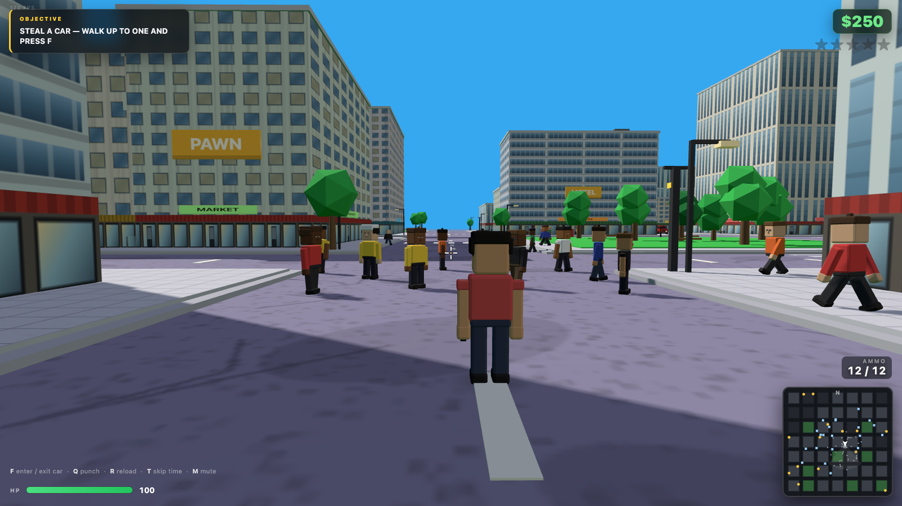

# Dude Theft Auto — Three.js sandbox

Fan-made, browser-based demake of the *Dude Theft Wars* formula: open-world city, drivable cars,
ragdoll pedestrians, shooting, wanted level and police chase. Everything 3D is **generated in code**
(no model files: buildings, cars, characters and textures are built procedurally at runtime).

Repo: https://github.com/himanusia/dude-theft-three (private)



## Stack

**TypeScript (strict) + Vite.** No JS source left: `src/*.ts`, `tsc --noEmit` clean under
`"strict": true`. Three.js comes from npm (no vendored copy).

```bash
npm install
npm run dev        # http://localhost:5173 (hot reload)
npm run typecheck  # tsc --noEmit, strict
npm run build      # typecheck + bundle to dist/
./run.sh           # install (if needed) + build + serve dist/ on :8765
python3 serve.py   # serve the built dist/ (threaded, IPv4 + IPv6 loopback)
```

`file://` does not work (ES modules + audio fetch); always serve over HTTP.
Desktop Chrome/Safari/Firefox with WebGL2.

## Theme: Indonesia (parody, no real brands)

Shop names, billboards and interiors are Indonesian **plesetan**, deliberately not the real
brands: `ALFAMURTI`, `INDOMERET`, `MARTABAK MART`, `WARTEG BAHARI`, `WARTEG SIAP JIWO`,
`BENGKEL AHOS`, `KOPI TUBRUK`, `WARKOP MELAYU`, `PULSA PERDANU`, `MIE GACUAN`, `SATE SENAYUN`,
`NASI PADANG SELONGSOR`, `JAMU GENDONG`, `TOKO EMAS MULYA`.

## Interiors (build once, reuse)

`src/interior.ts` is a config-driven kit: one room shell (floor, walls with a doorway, ceiling,
fluorescent panels, point light, door frame, exit pad) plus a per-kind layout.

| Kind | Layout |
|---|---|
| `minimarket` | 3 gondola rows with priced stock, glass drink coolers, counter + register + ATM, promo posters, baskets |
| `warteg` | glass display case with trays, menu board, tables + stools |
| `bengkel` | car lift, tool bench, tyre stacks, oil drums, service poster |
| `kopi` | bar counter, cup shelves, stools, chalkboard menu, hanging sachets |

Four rooms are built once and **all 72 shop doors reuse them** — walking into any minimarket
anywhere in the city drops you into the same shop. Enter/exit with `E`; while indoors the world
sim pauses and collisions switch to the room's own colliders.

## Controls

| Key | Action |
|---|---|
| `W A S D` | Move / drive |
| Mouse | Look (click canvas to lock the pointer) |
| Left click | Shoot (hold for auto cadence) |
| Right mouse (hold) | Aim — shoulder cam, character hidden |
| `Shift` | Sprint / brake |
| `Space` | Jump / handbrake |
| `E` | Enter / exit a shop interior |
| `F` | Enter / exit the nearest vehicle |
| `Q` | Punch |
| `R` | Reload |
| `T` | Skip time of day |
| `M` | Mute |
| `Esc` | Pause / resume |

## Art direction vs the reference

Assets were built by diffing against real *Dude Theft Wars* screenshots (kept locally in
`reference/`, not redistributed) and re-shooting the models in a neutral studio view
(`tools/asset-viewer.html`) after every change.

| Asset | Reference target | Result | What changed |
|---|---|---|---|
| Character | 1.75 m, head ≈ ¼ of height, no neck, blocky limbs, decal face | **8/10** | Head rebuilt to 0.44 m cube (4.4 heads tall), bevels 0.07 → 0.035 so faces read flat, chunky hands/shoes, 256² painted faces (eyes/brows/mouth), six expressions incl. sunglasses + moustache, five hair silhouettes, short-sleeve variant, nose geometry |
| Muscle car | 4.7 × 1.85 m, low, long hood, big wheels, open cockpit | **9/10** | Beveled body via `RoundedBoxGeometry`, wheel radius 0.34 → 0.40 with wheel wells + fender flares, full-width raked framed windshield, cockpit tub/dash/steering wheel, "POLICE" door decals, mirrors, plate, exhausts, hood stripes |
| City block | light facades, blue glass, storefronts, signage | **8.5/10** | Reference palette (sky `#35A8F0`, asphalt `#8D86A8`, sidewalk `#C8C8D0`, grass `#37C24A`), three window styles, parapets, readable shop signs ("PIZZA", "GYM", "24/7"…), billboards, textured asphalt + paving, bins/hydrants/benches/traffic lights |
| Ragdoll | chunky body, reads as the same dude | **7/10** | Limb radius 0.075 → 0.095, cube head, flat-shaded materials matching the character palette |

Residual gap: the reference has hand-authored props (interiors, hats, weapon models, bespoke
vehicle silhouettes). This is a procedural interpretation, not a 1:1 copy.

## Floating-geometry audit

`window.__game._test.audit()` walks the live scene and reports every actor/prop whose lowest
point is not on the ground (`groundHeightAt(x,z)` per sidewalk/road):

```
{ "peds": [], "cars": [], "player": 0, "ragdolls": [], "props": [], "buildings": [] }
```

It found and fixed real floaters: benches with no legs, traffic-light heads hanging above the
mast, billboards 11 cm off the facade, police lightbars floating above the roof, shoes 1 cm into
the pavement, and pedestrians that lifted both feet during the walk cycle (the body now drops by
the pendulum lift, so the planted foot always touches the ground — works for LOD-frozen poses too).

## Verification

Automated harness (`puppeteer-core`) drives the real page and asserts **state**, not screenshots:

```bash
npm run test:qa        # 19/19 gameplay assertions
npm run test:interior  # 11/11 interior assertions
npm run test:audit     # floating-geometry audit
```

```
19/19 gameplay checks pass — boot, walk, sprint, jump+land, sidewalk step-up, enter/exit vehicle,
acceleration, shooting + ammo, punch, ragdoll settle, police spawn/approach, death respawn,
cash pickup, night lighting, pause/resume, perf budget, zero console errors
11/11 interior checks pass — doors registered, 4 reusable rooms, prompt, enter, walk inside,
exit, all four kinds reachable, audit clean indoors
audit: 0 floating actors, 0 floating props
```

## CI

`.github/workflows/ci.yml` gates every PR to `main` (plus manual `workflow_dispatch`) with two
required jobs:

- **typecheck + build** on `ubuntu-latest` — Node 20, cached npm, `npm ci`, `npm run typecheck`,
  `npm run build`.
- **headless qa + interior + audit** on `macos-latest` — the Chrome build `puppeteer-core` pins
  (`CHROME_PATH`), `dist/` served on `:8765`, then `tests/qa.mjs`, `tests/interior.mjs` and
  `tests/audit.mjs`.

The browser suites need a GPU. A CPU-only Linux runner falls back to software WebGL: measured on
`ubuntu-latest` the same build runs at **4 fps** (SwiftShader) and **14 fps** (Mesa llvmpipe at
320x200), while `animate()` clamps `dt` to 50 ms, so the time-based assertions (walk 2.5 m, jump +
land, accelerate to 15 km/h) cannot pass there. The macOS runner exposes a paravirtual Metal GPU
and holds **60 fps** at the harness viewport, so the suites run there.

Each suite exits non-zero when any check prints `FAIL`, so one red assertion fails the job; logs
and screenshots from a failed run are uploaded as the `ci-failure-evidence` artifact.

Current numbers: 85–140 fps (headless SwiftShader), ~900–1300 draw calls, ~100k triangles,
34 pedestrians (recycled around the player, detail LOD beyond 30 m), 9 parked cars, 10 traffic cars
(built "simple": no mirrors/plate/exhaust), instanced building doors, handles and steps
(4 draw calls instead of ~480), ~140 colliders, dynamic resolution scaling to protect frame time.

Bugs found and fixed across these passes:

- per-frame collision damage (one cruiser could kill in a second) → timestamp cooldowns
- `Esc` pause not firing without pointer lock; Resume immediately re-pausing because the lock
  request fires a transient unlock event (now suppressed for 600 ms)
- vehicles could park on top of the player; cars drove through each other; the driven car could be
  shoved by the separation pass
- crowd kept every pedestrian 40 m+ away (now recycled into a 14–48 m ring)
- floating props/limbs (see audit above), ghosted toast stack, missing debug handles
- traffic recycling could teleport a car on top of the player (now excluded within 40 m)

## What is implemented

- **City**: 7×7 block grid, ~350 m across. Procedural towers (3 window styles, parapets, billboards,
  readable shop signs, awnings, doors with steps), parks, parking lots, street lamps (4 point lights
  re-parked on the nearest lamps each frame), textured asphalt/pavement, bins, hydrants, benches with
  legs, kerb-mounted traffic lights, sidewalk trees, stunt ramps, crosswalks, drifting clouds.
  Day/night cycle (~5 min) with emissive windows, street lighting, stars, moonlight.
- **On foot**: third-person controller, sprint, jump, sidewalk step-up, building collision,
  solid vehicles, slow health regen out of combat.
- **Vehicles**: arcade bicycle-model physics, collisions, damage, wreck explosions, air time off
  ramps, headlights at night, engine/tyre audio, 4 body types (sedan, muscle convertible, van, taxi)
  plus police cruisers with lightbar and door livery.
- **Combat**: hitscan pistol, 12-round mag, reload, tracers, muzzle flash, sparks, hitmarker,
  ray-vs-AABB against buildings and sphere tests against peds/cars.
- **Ragdolls**: 11-point Verlet ragdoll, ground friction, building push-out, fade + cleanup.
- **Police**: 0–5 wanted stars, cruisers spawn on the nearest road and chase, shoot at 2+ stars,
  arrest when they pin you on foot, wanted level decays over ~30 s.
- **Economy/objectives**: cash pickups, cash for ragdolling peds, hospital bill, arrest fine,
  4-step objective chain (steal a car → cause chaos → reach 3 stars → lose the cops).
- **HUD**: objective card, cash chip, wanted stars, health, ammo, speedometer, contextual prompt,
  toast stack, rounded minimap with FOV wedge and compass, FPS counter.

## What is not implemented (honest scope)

No interiors, no story missions, no multiplayer, no planes/helis/bikes, no weapon variety,
no character customisation, no save system, no touch controls, and police AI is a straight-line
chase (no pathfinding, so cruisers scrape walls). Audio is a small CC0 kit, not a full sound pass.

## Assets & licences

3D geometry/materials/textures: procedural (`src/city.js`, `src/character.js`, `src/car.js`,
`src/ragdoll.js`; `vendor/RoundedBoxGeometry.js` is vendored from three.js examples).

| Asset | Source | Licence |
|---|---|---|
| SFX: impacts, punches, footsteps, metal, glass | Kenney — *Impact Sounds* | CC0 |
| SFX: laser shots, pickups, UI clicks | Kenney — *Digital Audio* | CC0 |
| SFX: engine loop, explosions, rifle | Kenney — *Sci-Fi Sounds* | CC0 |
| Music: "Funkorama", "Sneaky Snitch", "Wallpaper" | Kevin MacLeod (incompetech.com) | CC BY 4.0 |
| Siren, tyre screech, canvas textures | generated at runtime | — |

Music attribution (keep if you publish):
*"Funkorama", "Sneaky Snitch", "Wallpaper" — Kevin MacLeod (incompetech.com), licensed under
Creative Commons: By Attribution 4.0 (CC BY 4.0).*

Fan prototype, not affiliated with Poxel Studios; *Dude Theft Wars* is their trademark.
Reference screenshots in `reference/` are third-party promo images used only for private
comparison and are git-ignored.

## Source map

```
index.html                     HUD markup, CSS, import map
src/main.js                    bootstrap, input, camera, player, combat, objectives, loop
src/city.js                    world generation, buildings, roads, props, day/night, lights
src/car.js                     vehicle mesh + arcade physics
src/traffic.js                 ambient traffic AI on the road grid
src/character.js               procedural humanoid + walk/aim animation (shared asset cache)
src/ragdoll.js                 verlet ragdoll
src/npc.js                     pedestrians (walk / flee / die)
src/police.js                  wanted level, pursuit, arrest
src/hud.js                     DOM HUD + minimap
src/audio.js                   WebAudio sfx / bgm / engine / siren
src/utils.js                   math, ray helpers, canvas textures, rounded box, contact shadow
tools/asset-viewer.html        studio view used to compare assets with the reference
```
