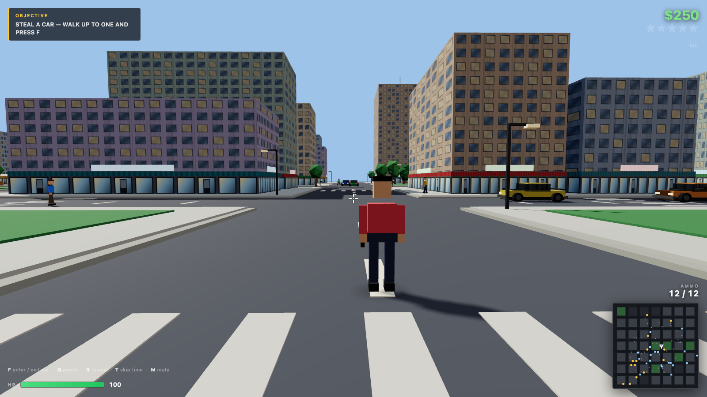

# Dude Theft Auto — Three.js sandbox

Fan-made, browser-based demake of the *Dude Theft Wars* formula: open-world city, drivable cars,
ragdoll pedestrians, shooting, wanted level and police chases. Everything 3D is **generated in code**
(no model files, no image textures — building/window/shopfront textures are drawn on canvas at runtime).



## Run it

```bash
./run.sh          # serves on http://localhost:8765 and opens the browser
# or
python3 serve.py 8765
```

Needs a local HTTP server (ES modules + audio fetch do not work from `file://`).
Desktop Chrome/Safari/Firefox with WebGL2. No build step, no dependencies to install.

## Controls

| Key | Action |
|---|---|
| `W A S D` | Move / drive |
| Mouse | Look (click canvas to lock the pointer) |
| Left click | Shoot (hold for auto cadence) |
| Right mouse (hold) | Aim — shoulder cam, character hidden |
| `Shift` | Sprint / brake |
| `Space` | Jump / handbrake |
| `F` | Enter / exit the nearest vehicle |
| `Q` | Punch |
| `R` | Reload |
| `T` | Skip time of day |
| `M` | Mute |
| `Esc` | Pause (pointer unlock) |

## What is implemented

- **City**: 7×7 block grid, ~350 m across. Procedural towers with canvas-generated window + shopfront
  textures, parks, parking lots, street lamps (4 real point lights re-parked on the nearest lamps),
  sidewalk trees, props, stunt ramps, crosswalks. Day/night cycle (5 min) with emissive windows,
  street lighting, stars, moonlit hemisphere.
- **On foot**: third-person controller, sprint, jump, sidewalk step-up, building collision.
- **Vehicles**: arcade bicycle-model physics (accel / drag / speed-dependent steering / handbrake),
  collisions, damage, wreck explosions, air time off ramps, headlight at night, engine + tyre audio.
  9 parked cars + 12 ambient traffic cars that navigate the road grid.
- **Combat**: hitscan pistol with 12-round mag, reload, tracers, muzzle flash, sparks, hitmarker,
  2.5D ray-vs-AABB against buildings and sphere tests against peds/cars.
- **Ragdolls**: 11-point Verlet ragdoll with distance constraints, ground friction and building
  push-out. Pedestrians convert to ragdolls when shot, punched or hit by a car (launch velocity
  from the impact direction).
- **Police**: 0–5 wanted stars from crimes, police cruisers spawn on the nearest road and chase,
  shoot at 2+ stars, arrest when they pin you on foot, wanted level decays over ~30 s.
- **Economy / objectives**: cash pickups, cash for ragdolling peds, hospital bill on death,
  fine on arrest, 4-step objective chain (steal a car → cause chaos → reach 3 stars → lose the cops).
- **HUD**: cash, health, wanted stars, ammo, speedometer, prompt line, toasts, live minimap
  (blocks, roads, peds, cops, traffic, pickups, player heading), FPS counter.

## What is *not* implemented (honest scope)

This is a vertical slice, not the full game: no interior models, no missions/story, no multiplayer,
no planes/helis/bikes, no melee weapon variety, no character/vehicle customisation, no save system,
no mobile touch controls, and the police AI is a straight-line chase (no pathfinding around blocks,
so they sometimes scrape walls). Audio is a small CC0 kit, not a full sound design pass.

## Assets & licences

3D geometry, materials and textures: **procedural, generated at runtime** (`src/city.js`,
`src/character.js`, `src/car.js`). No third-party meshes.

| Asset | Source | Licence |
|---|---|---|
| SFX: impacts, punches, footsteps, metal, glass | Kenney — *Impact Sounds* | CC0 |
| SFX: laser shots, pickups, UI clicks | Kenney — *Digital Audio* | CC0 |
| SFX: engine loop, explosions, metal hits | Kenney — *Sci-Fi Sounds* | CC0 |
| Music: "Funkorama", "Sneaky Snitch", "Wallpaper" | Kevin MacLeod (incompetech.com) | CC BY 4.0 — attribution required |
| Siren, tyre screech | synthesized with WebAudio | — |

Music attribution (keep it if you publish):
*"Funkorama", "Sneaky Snitch", "Wallpaper" — Kevin MacLeod (incompetech.com), licensed under Creative Commons: By Attribution 4.0 (CC BY 4.0).*

Fan prototype. Not affiliated with Poxel Studios; *Dude Theft Wars* is their trademark.

## Source map

```
index.html          HUD markup, CSS, import map
src/main.js         bootstrap, input, camera, player, combat, objectives, loop
src/city.js         world generation, buildings, roads, props, day/night, lights
src/car.js          vehicle mesh + arcade physics
src/traffic.js      ambient traffic AI on the road grid
src/character.js    procedural humanoid + walk/aim animation (shared geometry cache)
src/ragdoll.js      verlet ragdoll
src/npc.js          pedestrians (walk / flee / die)
src/police.js   wanted level, pursuit, arrest
src/hud.js          DOM HUD + minimap
src/audio.js        WebAudio sfx/bgm/engine/siren
src/utils.js        math, ray helpers, canvas textures, contact shadow
```
